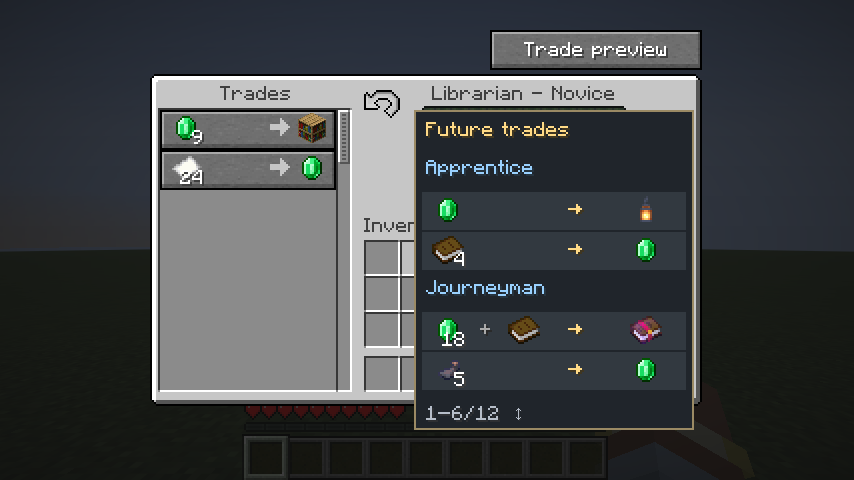

# TradeView

A Minecraft mod that shows a villager's **future trades** for every level it has not reached yet,
right in the trading screen. It also adds auto-trading, trade rerolling, an enchanted-book finder
and an optional "unlimited trades" mode.



## Supported versions

| Minecraft | Fabric | NeoForge | Forge |
|---|---|---|---|
| 1.20.1 | ✔ (Java 17) | – | ✔ (Java 17) |
| 1.21.1 | ✔ (Java 21) | ✔ | ✔ |
| 1.21.11 | ✔ (Java 21) | ✔ | – |
| 26.2 | ✔ (Java 25) | ✔ | ✔ |
| 26.3 | ✔ (Java 25) | ✔ | ✔ |

All builds share the full 1.2.0 feature set.

## Installation

Drop the JAR matching your Minecraft version **and** loader (e.g. `tradeview-1.2.0-1.21.1-fabric.jar`)
into your `mods` folder. Fabric additionally needs Fabric API; NeoForge and Forge need nothing else.

- **Singleplayer:** install on your client.
- **Multiplayer:** install on the server **and** on every client that should see the preview.
- Optional: [Mod Menu](https://modrinth.com/mod/modmenu) (Fabric) for the settings screen. On
  NeoForge/Forge use the `Config` button in the mod list, or `/tradepreview config` on any loader.

## Features

### Trade preview
Opening the trading screen of a villager below Master shows all remaining levels with their concrete
offers. Scroll with the mouse wheel and hover items for full tooltips (e.g. book enchantments).
The preview can be shown **beside the trade list** or **inline** as greyed-out rows below the
regular trades. Prices shown are base prices; reputation, demand and discounts still apply later.
Masters and wandering traders have no preview.

### Auto-trade (Shift + T)
Select an offer and press the hotkey: TradeView repeats that trade (max. 10/s), refilling the slots
from your inventory. It stops when ingredients run out, the offer locks, the inventory is full, or
you press the hotkey again / click / close the screen. Works without TradeView on the server.

### Reroll (↻ / R)
While a villager has never been traded with, a **↻** button (or the **R** key) regenerates its
novice trades and the preview. Requires TradeView on the server.

### Find enchanted books
`/tradepreview find <enchantment> [level]`, then open a librarian's trading screen. TradeView rerolls
until a book with exactly that enchantment level shows up in the current trades or the preview.
Stop with `/tradepreview find stop`. Requires TradeView on the server.

### Unlimited trades
Off by default. When enabled, villagers and wandering traders can repeat offers indefinitely.
Server-wide setting, changeable by the singleplayer host or an operator.

### Update check
Optionally checks once per game session (singleplayer only) for a newer version and posts a
local chat notice. Can be disabled in the settings.

### Commands
`/tradepreview on|off`, `/tradepreview side left|right`, `/tradepreview config`,
`/tradepreview find …`. Settings are stored in `config/tradeview.properties` and
`config/tradeview-server.properties`.

## How the prediction works

Vanilla Minecraft only rolls a villager's next trades when it levels up. TradeView rolls them in
advance using the game's own trade generator (including item components, enchantments and biome
conditions) and stores them on the villager. They survive reloads and restarts and are applied
exactly when the villager levels up — so the preview shows **reserved** trades, not a vanilla future.

## Compatibility

- [Trade Cycling](https://modrinth.com/mod/trade-cycling): cycling discards and regenerates the preview.
- [Hero of the Village Plus](https://www.curseforge.com/minecraft/mc-mods/hero-of-the-village-plus-better-villagers-and):
  player-dependent bonus trades appear in the preview without being unlocked for others.
- [Reliable Remover](https://www.curseforge.com/minecraft/mc-mods/reliable-remover): removed trades
  are hidden from the preview.

None of these are hard dependencies.

## Building

Requires JDK 25+. From the repository root:

```sh
./gradlew build                      # all Fabric and NeoForge variants (Stonecutter) + GameTests
./gradlew :26.3-fabric:build         # a single variant
```

The Forge ports are standalone Gradle projects:

```sh
cd versions/26.3-forge && ./gradlew build   # also 26.2-forge, 1.21.1-forge, 1.20.1-forge
```

JARs end up in `versions/<minecraft>-<loader>/build/libs/`.

### Project layout

- `src/common*` – loader-independent code per Minecraft version family
- `src/fabric*`, `src/neoforge*`, `src/forge*` – loader entrypoints, networking and metadata
- `src/gametest*`, `src/validation*` – tests and validation fixtures (not shipped)
- `versions/` – per-version Stonecutter nodes and the standalone Forge projects

## License

[MIT](LICENSE)
